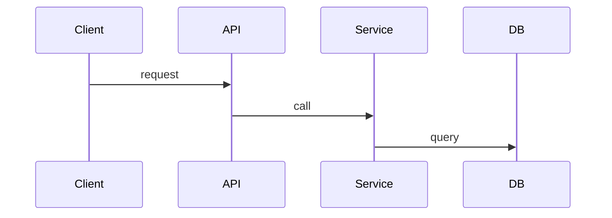

# Tech Spec: <Feature name>
PRD: docs/product/<slug>.md   Status: Draft | Approved   Date: <yyyy-mm-dd>

## Summary
<3–5 sentences: approach in plain language.>

## Current state
<Relevant existing code/patterns, with file paths.>

## Proposed design
### Components touched
| Component | Change | Files |
|---|---|---|
### Data model
<Tables/fields/types/indexes; migration (reversible).>
### API contracts
```http
POST /api/v1/<resource>
{ "field": "value" }
→ 201 { "id": "..." }   400 { "error": "..." }
```
### Flow


## Alternatives considered
| Option | Pros | Cons | Decision |
|---|---|---|---|

## Failure modes & error handling
## Security & privacy
## Performance & scalability
## Observability (logs, metrics, alerts)
## Rollout & rollback (feature flag? migration order?)
## Test strategy (unit / integration / e2e; key cases)
## Open questions / ADRs needed
